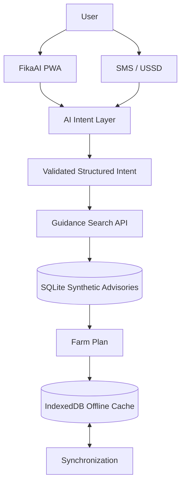

# FikaAI

## Farming guidance that works when signal doesn't.

An offline-first farm-advisory prototype. It helps smallholders, extension officers and cooperatives look up crop and livestock problems, save a field plan on the phone, and reach the same guidance by SMS or USSD on a basic handset.

This is **not** a replacement for a certified agronomist or veterinarian, a live national advisory service, or a source of verified dosage and product recommendations.

### Problem

Farm problems do not wait for good coverage. A farmer or extension officer may be in a remote plot when a pest, nutrient or disease question comes up. Guidance that needs a live connection, or that disappears when the network drops mid-task, is not much use in the field. See [`PROBLEM.md`](PROBLEM.md).

### Solution

FikaAI helps a user:

* describe a crop or livestock problem in plain English or Kiswahili
* get ranked advisory pathways from a local synthetic advisory library, with field checks to confirm before acting
* see urgency, cautions and a reminder to confirm rates with an extension officer or agrovet
* save a field plan with a step checklist and keep it on the device
* tick steps and log observations with no signal, then sync when the connection returns
* reach the same guidance by SMS or USSD on a feature phone
* print a bilingual dial sheet for agrovet counters and noticeboards

### MVP

Features implemented in this repository:

* Natural-language guidance search with structured intent extraction (crop, region, symptom, category)
* Deterministic ranking over a synthetic advisory library (14 demo advisories: nutrient, pest, disease, water, planting, livestock, including 4 poultry)
* Advisory detail with field checks, remediation, caution, demo-data badge and last-updated label
* Farm plan creation and persistence, with step progress and field observations
* Offline continuity via service worker shell cache and IndexedDB plan cache
* Browser online/offline detection and reconnect sync (`pending` → `syncing` → `synced` / `failed`)
* Simple feedback capture
* Hazard safety layer for pesticide poisoning and sudden animal or flock deaths (redirects to medical, veterinary or extension help; no diagnosis)
* AI failure fallback via deterministic keyword intent mapping
* SMS and USSD simulators (`*384*40#`, demo codes) in English and Kiswahili, including sale recording and a menu-driven poultry guide (`*384*40*5#`: stage, then feeding, care, vaccines, housing or hygiene, in screens under 182 characters)
* Poultry life-stage guide (hatching, brooding, growers, adult layers) covering feeding, care, vaccination, accommodation and hygiene, with a vaccination schedule table and vet red flags; cached on the device for offline use; also shipped as static `public/poultry-guide.json` so the tab works on static hosts (regenerate with `npm run build:poultry` after editing the guide)
* Plain-language privacy notice at `/privacy.html` (operator contact still to be added before launch)
* Photography: hero, per-stage poultry photos and empty states use optimised WebP files in `public/img/` (640 px and 1280 px, 640 px precached for offline)
* Mobile layout with a bottom tab bar (screens up to 720px wide)
* Printable bilingual dial sheet at `/cheatsheet.html`

### Design

The interface follows the **Field Utility & Agronomy Directive** design system: flat, high-contrast and readable in direct sun.

| Token | Value |
| --- | --- |
| Harvest Amber (alerts, focus) | `#C87D28` |
| Deep Botanical Forest (primary actions) | `#144532` |
| Earth Slate (secondary text) | `#5C675E` |
| Charcoal Ink (text) | `#18201C` |
| Canvas / cards / borders | `#F3FCF5` / `#FFFFFF` / `#E2DDD2` |
| Headlines | Bricolage Grotesque |
| Body and data | Atkinson Hyperlegible Next |

No blur, glass or diffuse shadows. Depth comes from tone and 1px borders. Interactive targets are at least 48px.

### How AI Is Used

| Item | Detail |
| --- | --- |
| Hosted model | ModelScope OpenAI-compatible API — configurable Qwen 3.x (default `Qwen-Ambassador/Qwen3.7-Max`) |
| Local model | Ollama `qwen2.5:3b` (optional) |
| Fallback | Deterministic crop/symptom keyword mapping + mock last resort |
| Selection | `LLM_PROVIDER=auto\|ollama\|modelscope\|mock` |

Flow:

1. User enters a natural-language question
2. AI (when available) returns structured intent JSON
3. Intent is validated before use
4. The application ranks stored advisories deterministically
5. Results shown to the user come from the stored advisory library

> AI is used for intent understanding, not for diagnosis or for inventing advice.

AI does **not** invent advisories, product names, application rates, or diagnoses.

### Offline Architecture

* **Service worker** caches the PWA shell (`index.html`, `cheatsheet.html`, CSS, JS, manifest, icon)
* **IndexedDB** stores the active farm plan, advisory snapshot, pending actions and recent search cache
* **Offline mode** shows a clear Offline status and keeps the saved plan readable and tickable
* **Pending actions** (for example a field observation) are stored locally and marked `pending`
* **Reconnect** listens for the browser `online` event, shows the synchronizing state, then marks `synced` (or `failed` with retry)
* The backend demo connectivity toggle remains available for SMS/USSD and API demos

### Data

> The advisories in this prototype are synthetic demonstration data. They are not verified agronomic or veterinary advice. Product names, rates and thresholds must be confirmed with a certified extension officer, agrovet or vet.

Each record carries a demo-data indicator and a last-updated label. Contact numbers and short codes shown in the app and on the dial sheet are demo placeholders, not live services.

### Responsible AI

* No diagnosis
* Poisoning and sudden-animal-death language triggers a redirect to medical, veterinary or extension help
* The stored advisory library is the source of truth for guidance content
* Synthetic data is clearly labelled everywhere it appears
* Minimal data collection
* Offline plan state stays on the device until sync
* Documented limitations: prototype scope, synthetic library, optional AI providers

### Architecture



### Technologies

| Layer | Technology |
| --- | --- |
| Runtime | Node.js 22+ |
| Backend | Express |
| Frontend | Vanilla JavaScript PWA (`public/`) |
| Database | SQLite via `node:sqlite` |
| AI (hosted) | ModelScope OpenAI-compatible API · Qwen 3.x |
| AI (local) | Ollama · `qwen2.5:3b` |
| AI (fallback) | Deterministic keyword intent mapping · mock LLM |
| Offline / PWA | Service worker · Web App Manifest · IndexedDB |
| Sync | Browser `online`/`offline` events · plan action queue |
| Secondary channels | SMS simulator · USSD simulator |
| Tests | Vitest |
| Package manager | npm |

### Installation

Requirements: Node.js 22+.

```bash
cp .env.example .env
npm install
npm run seed
npm run dev
```

Open http://127.0.0.1:3000

Optional local AI:

```bash
ollama serve
ollama pull qwen2.5:3b
```

Optional hosted AI smoke (requires `MODELSCOPE_API_KEY` in local `.env`):

```bash
npm run smoke:modelscope
```

Force re-seed:

```bash
node scripts/seed.js --force
```

### Environment Variables

See `.env.example`. Never commit real secrets.

| Variable | Default | Purpose |
| --- | --- | --- |
| `PORT` | `3000` | Local port |
| `HOST` | `127.0.0.1` | Bind address |
| `DATABASE_PATH` | `./data/fikaai.sqlite` | SQLite file |
| `OLLAMA_BASE_URL` | `http://127.0.0.1:11434` | Local Ollama |
| `OLLAMA_MODEL` | `qwen2.5:3b` | Local model |
| `OLLAMA_ENABLED` | `true` | Enable/disable Ollama |
| `MODELSCOPE_BASE_URL` | ModelScope inference URL | Hosted API |
| `MODELSCOPE_API_KEY` | _(empty)_ | Hosted key — local `.env` only |
| `MODELSCOPE_MODEL` | `Qwen-Ambassador/Qwen3.7-Max` | Hosted model allowlist entry |
| `LLM_PROVIDER` | `auto` | `auto` \| `ollama` \| `modelscope` \| `mock` |
| `DEFAULT_USER_ID` | `demo-user` | Local demo user |
| `CONNECTIVITY_MODE` | `online` | Demo backend online/offline start mode |
| `AUTH_REQUIRED` | `false` | `true` makes every user API call need a signed-in session (set this in production) |
| `AUTH_DEMO_CODES` | `false` | `true` returns the SMS code in the API response — local demos only, never in production |
| `AT_USERNAME`, `AT_API_KEY` | _(empty)_ | Africa's Talking SMS credentials; without them codes are printed to the server log |
| `AT_SENDER_ID`, `AT_SANDBOX` | _(empty)_, `false` | Optional sender ID and sandbox switch |

Sign-in is phone number + 6-digit SMS code (10-minute expiry, 3 codes per 15 minutes, 5 attempts), with 30-day sessions stored as hashes. The Africa's Talking sender is written to the provider's documented API but has not been run against a live account. Sign-in needs the Node backend; the static Vercel build has no API and runs in local mode.

## Deployment

The app is deployed in two places:

* **Render** (`https://fikaai.onrender.com`) runs the Node backend and also serves the web app, so sign-in, SMS, USSD and the Africa's Talking callbacks work there. `render.yaml` is a blueprint with the settings it needs (`HOST=0.0.0.0`, health check, generated `AT_WEBHOOK_SECRET`). Free instances sleep when idle, so the first request after a quiet period can take about 30 seconds. SQLite is wiped on every deploy unless you attach a paid persistent disk (see the commented lines in `render.yaml`).
* **Vercel** (`https://fikaai.vercel.app`) serves the static files only. `vercel.json` forwards `/api/*` to the Render backend so the Vercel site gets the same features. If the backend is asleep or down, the app falls back to its cached, offline mode.

Point Africa's Talking callbacks at the Render URL, not Vercel.

### Testing

```bash
npm test
```

76 tests across agent, channels, offline queue, data, LLM provider, e2e and guidance suites.

Guidance coverage includes intent fallback, malformed AI rejection, hazard safety, advisory ranking, plan create, pending action, sync, feedback and offline-backend search fallback.

### Demo

Recommended sequence:

1. Open http://127.0.0.1:3000
2. Enter: `Maize leaf yellowing in Kiambu`
3. Show structured intent and ranked advisories (demo-data badges)
4. Open the top advisory and review field checks, caution and last-updated label
5. Save it to a farm plan
6. Disable network (DevTools Offline or Wi‑Fi off)
7. Confirm Offline status; tick a step and log an observation (pending)
8. Restore network → synchronizing → synced
9. Open the SMS / USSD tab and try `*384*40#` or an SMS such as `Mahindi yangu yana wadudu Kiambu`
10. Open `/cheatsheet.html` to show the printable dial sheet

### Layout

```text
src/guidance       Intent, hazard safety, synthetic advisories, poultry guide (+ short USSD text), guidance flow
src/server         HTTP API + static PWA
src/llm            ModelScope / Ollama / mock router
src/storage        SQLite schema + repository
src/offline        Legacy channel queue sync
src/channels       SMS / USSD simulators
public             Field-ready PWA (IndexedDB + service worker) and dial sheet
scripts/seed.js    Demo advisory seeding
tests              Vitest
```
